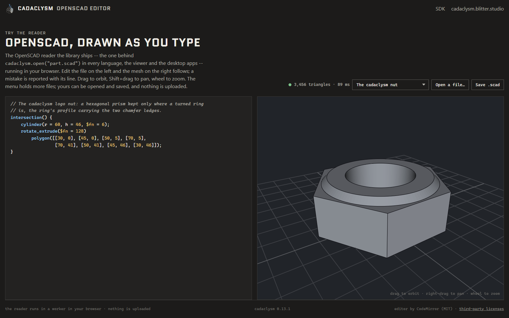

# cadaclysm OpenSCAD editor

An OpenSCAD editor that runs in the browser. Type OpenSCAD on the left and see, on the right,
the solid that the [cadaclysm](https://cadaclysm.blitter.studio/) OpenSCAD reader builds from
it, redrawn as you type. A mistake is reported with its line, and the view keeps the last file
that read. The menu holds six example files. You can open a `.scad` file of your own, save
the text back as `.scad`, and export the solid as STEP, BREP, STL or glTF.

The kernel runs in a worker in your browser, so nothing is uploaded.



The cadaclysm logo, the nut struck by lightning, written in OpenSCAD: the last example in the menu (`?example=nut`).

## Architecture

```
index.html ── openscad.js ─────────── CodeMirror 6 editor (vendor/editor.js, from editor.js)
                │  openscad-script.js   the example files
                │  pkg/viewer-client.js   the view's canvas, transferred to the worker,
                │  pkg/view-activation.js its size, input and picks
                ▼
            openscad-worker.js (module worker) ── pkg/  (the cadaclysm web package)
                open(text, "scad") -> Scene      the OpenSCAD reader: CSG to solids
                pkg/viewer-host.js -> View       draws it (WebGPU, WebGL2 fallback)
```

- **The editor** is [CodeMirror 6](https://codemirror.net/) with a small OpenSCAD tokenizer
  for colouring (`editor.js`), bundled by esbuild into `vendor/editor.js`. A keystroke waits
  250 ms for the next one before the text is read. Ctrl-Enter (or Shift-Enter) reads it at once.
- **The worker** (`openscad-worker.js`, a module worker) loads the package's WebAssembly
  module and reads each text with `open(bytes, "scad", undefined, "native")`. This is the same
  OpenSCAD reader that sits behind `cadaclysm.open("part.scad")` in every SDK language. It
  runs the program and builds its CSG (unions, differences, hulls, extrusions and the rest) as
  exact solids, with the file's own colours and their edges. One read runs at a time. The
  newest text waits behind it, and an answer for text that has since changed is dropped.
  A fresh file (the first one, a new example, an opened file) is read twice: first with
  `preview(bytes, "scad", "native")`, the same parts as quick meshes faceted at the file's
  `$fn`, drawn at once, then exactly. Edits go straight to the exact read. A package without
  `preview` reads exactly every time.
- **Drawing.** The worker also owns the package's `View`, on an OffscreenCanvas that the page
  hands over (`pkg/viewer-client.js` on the page, `pkg/viewer-host.js` in the worker). Only the
  triangle count and the read time come back to the page. The View draws it with WebGPU where the browser has it and falls back to WebGL2 otherwise
  (`?backend=webgl2` forces it). The camera keeps its place across edits unless the model
  outgrows the frame. Drag to orbit, right-drag to pan, wheel to zoom, double-click to frame
  what you hit.
- **Crashes.** If the module traps (for example, out of memory on a huge `$fn`), the worker
  reports it, and the page replaces the worker and its canvas and reads the text again.
- **Downloads.** *Save .scad* downloads the editor's text. *Open a file…* reads a `.scad`
  file locally.
- **Export.** *Export…* writes the solid on screen (the last exact read; not offered over a
  preview or a failed read) as STEP, BREP (OCCT's `.brep`), STL or glTF (`.glb`), in the
  worker (`openscad-export.js`). The kernel reads the text again as solids with
  `cadaclysm_blacksmith_open_file(bytes, "scad")`. Those solids carry no colours, so each one
  gets its colour back from the read scene's tree before the file is written. The menu is
  shown only for a kernel package.

## Setup

You need Node.js 20 or later.

```bash
npm install
npm run setup
npm run build
```

`npm run setup` puts the `pkg/` folder of the cadaclysm web package here. That folder
holds the WebAssembly module (the readers, the kernel and the View) and its loader. It also holds the
page modules that go with the View, which the editor imports from there instead of keeping
copies: `viewer-host.js` and `viewer-client.js` (a View in a worker, drawing a canvas the
page hands over), `view-activation.js` (tap the view to turn it on) and `view-canvas.js`
(the canvas's capped drawing size). It is fetched from the
[SDK's releases](https://github.com/rdeioris/cadaclysm-sdk/releases) and never committed.
The editor needs the `View` class, which the web package has from 0.14 on. A package you
already have works too: `npm run setup -- --zip <package.zip>`, or a `pkg/` folder with
`npm run setup -- --pkg <folder>`.

`npm run build` bundles CodeMirror into `vendor/editor.js`.

## Run

```bash
npm start
```

Then open http://localhost:8000/. Any static server works, as long as it serves `.wasm` files
as `application/wasm` (`python -m http.server`, `npx serve`). The page is plain ES modules,
with no build step beyond `vendor/`. `?example=gear` opens on another example.

### Licensing the module

Without a license, the module runs in full and prints a notice in the browser console whenever
a file is read. For a site other people use, put your license (`cadaclysm.lic`, as its URL or
its text) in `LICENSE` near the top of `openscad-worker.js`. See
https://cadaclysm.blitter.studio/license. `*.lic` files are git-ignored.

## Test

```bash
npm test
```

The tests run under Node:

- `test/openscad.mjs` reads every example through the package, as the worker does, and checks
  that each one draws (triangles, feature edges, a size), that the colours example keeps its
  colours, and that a broken file comes back as the reader's error with its line.
- `test/worker-crash.mjs` checks that the worker reports a WebAssembly trap as a crash, and
  rethrows any other error.
- `test/editor.mjs` checks what the OpenSCAD tokenizer colours a file as.

## Files

| | |
|---|---|
| `index.html`, `openscad.js` | the page: editor, toolbar, status line |
| `openscad-worker.js` | the module worker: the reader and the View |
| `openscad-script.js` | the example files |
| `editor.js` | the CodeMirror editor and the OpenSCAD tokenizer (bundled into `vendor/`) |
| `chrome.css`, `notebook.css`, `font/`, `favicon.svg`, `mark-dark.svg` | the look |
| `scripts/setup.mjs`, `scripts/serve.mjs` | fetch the package; a static server |

## License

The editor's own code is under the Apache License 2.0 (see [LICENSE](LICENSE)). CodeMirror
and its packages are MIT, and the Quantico font is under the SIL Open Font License (see
[THIRD-PARTY.txt](THIRD-PARTY.txt)). The cadaclysm web package that `npm run setup` fetches has
its own license and is not part of this repository. The cadaclysm name and logo are not covered
by the Apache license.

Links: [cadaclysm SDK](https://github.com/rdeioris/cadaclysm-sdk) ·
[cadaclysm.blitter.studio](https://cadaclysm.blitter.studio/)
